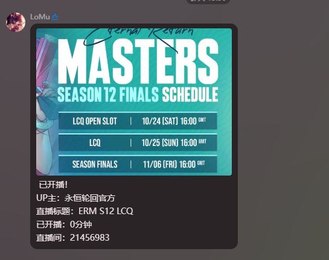
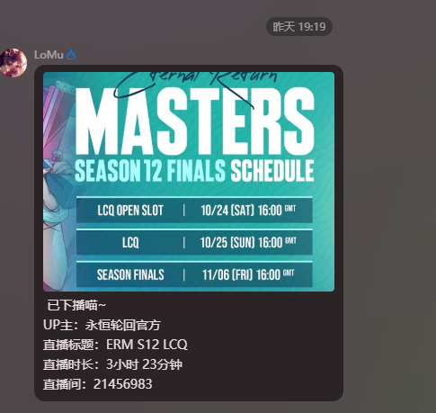
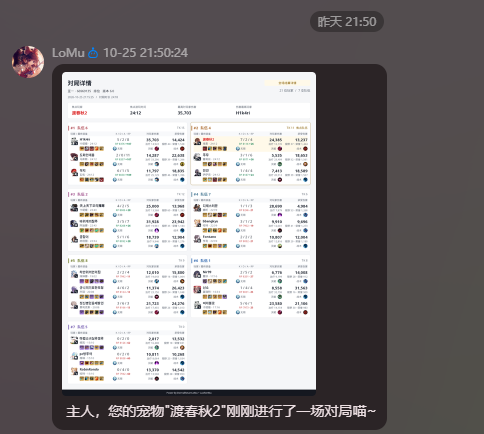
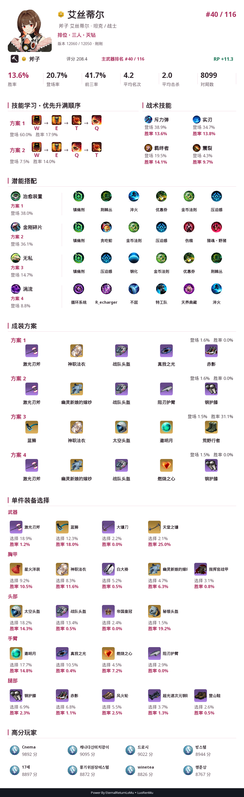
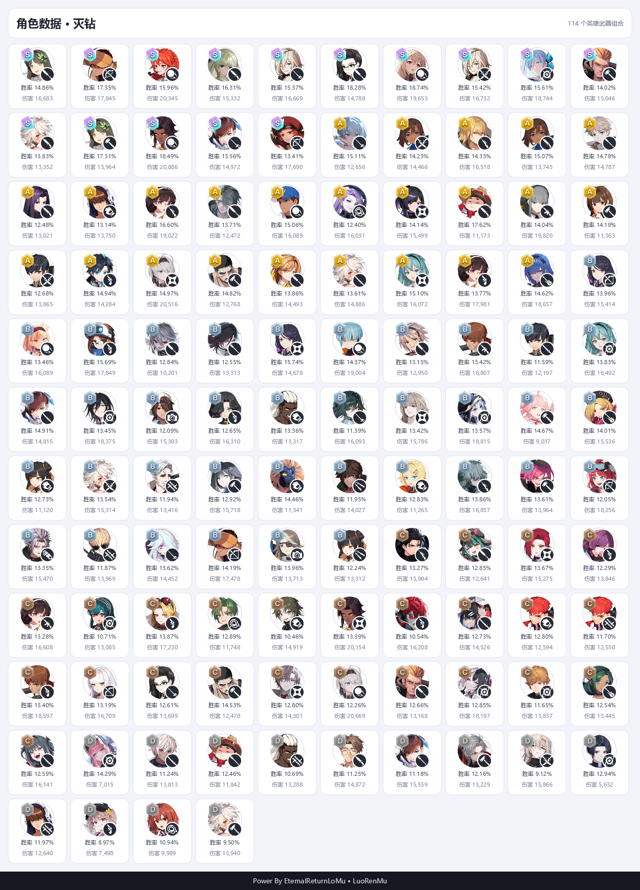
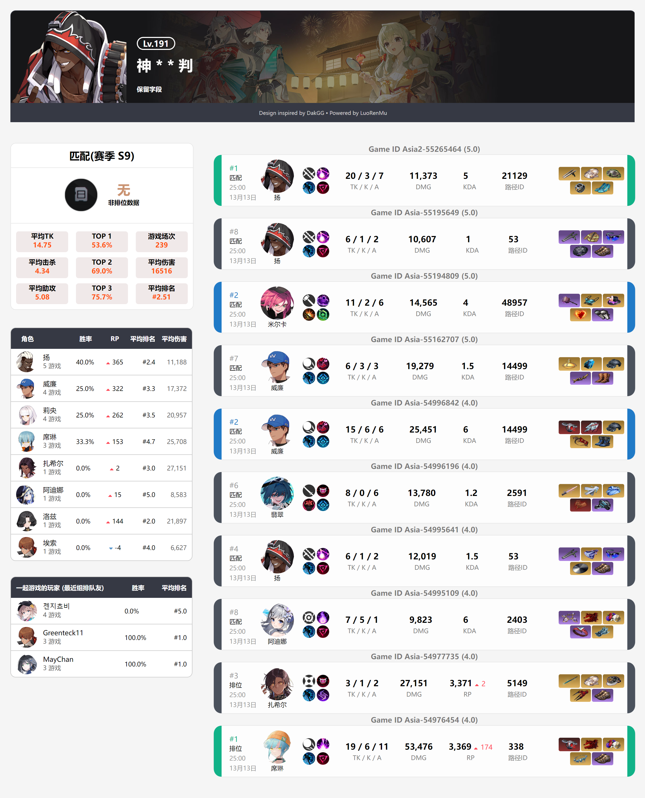
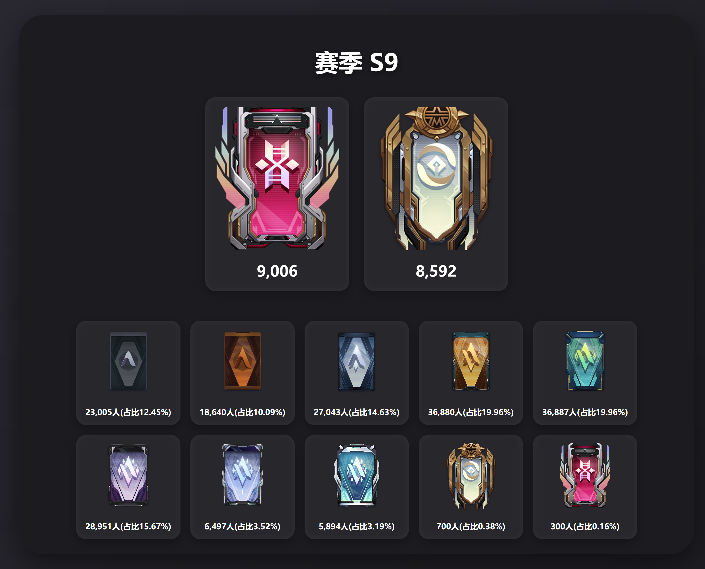
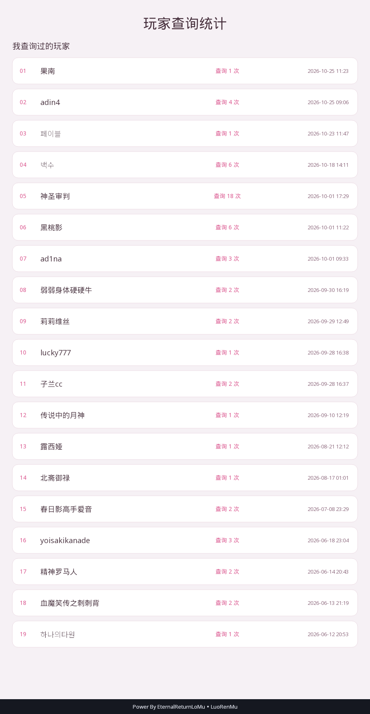

# EternalReturnLoMu

  

永恒轮回数据查询机器人，支持 **QQ 官方机器人** 与 **OneBot 11**。以图片展示玩家战绩、对局结算、角色与装备分析，并提供群宠追踪、B站直播通知、活动兑换码及 Web 管理后台。

## 玩家战绩与对局

- **玩家查询**：展示段位、RP、近期对局、角色、装备、伤害和 KDA，标注服务器及对局 ID；RP 涨跌用不同颜色区分。
- **对局详情**：展示各队伍的结算数据，按队伍区分颜色，焦点玩家昵称突出为红色；包含五件装备、武器、天赋和战术技能。
- **玩家别名**：支持个人与群内别名、自身昵称绑定、别名列表及删除；QQ 提供 Markdown 操作按钮。
- **查询统计**：记录玩家累计被查询次数及个人查询次数；热门玩家会获得额外评价文案。
- **段位统计**：查看服务器段位分布及永恒、半神分段数据。

## 角色与装备分析

- **角色详情**：按模式、段位和武器筛选，展示角色表现、出装及高分玩家。
- **技能推荐**：展示前两套技能方案、技能图标和优先升满顺序，不堆叠逐级加点步骤。
- **多武器选择**：角色拥有多种武器时，QQ 显示武器选择按钮，将对应命令填入输入框。
- **角色排行**：覆盖全部角色与武器组合，展示排名、胜率等统计，缺少数据时明确提示。
- **装备查询**：支持装备名称、拼音及 ID，展示属性、品质背景、合成树与高使用率角色。

## 群宠战绩追踪

发现订阅玩家的新对局后，向群内主动发送最新一局战绩图片，并附带：

> 主人，您的宠物"xxx"刚刚进行了一场对局喵~

- 每群最多订阅 **3 位玩家**，每次有效 **7 天**，到期自动停止；重复添加不延长有效期。
- **到期提醒**：订阅结束时主动告知已暂停监视；重新订阅同一玩家会撤销旧的待发提醒。
- 订阅前校验昵称并确认玩家存在；首次记录当前对局作为基线，不补发历史战绩。
- 根据玩家活跃程度调整检查间隔，同一玩家跨群共享查询与图片生成，避免重复请求。
- 一次发现多场新对局时只发送最新一局；查询或发送失败保留订阅和进度，退避后重试。
- **未游玩提醒**：最近一局距今满 3 天时主动发送关怀文字，显示未游玩的天／时／分；同一次未游玩状态只提醒一次，恢复游玩后重新计时。
- 群主关闭主动消息或权限无法确认时暂停检查，恢复权限后继续；玩家被明确确认不存在时停止对应任务。
- 持久化记录成功推送次数，取消订阅不清空累计统计。

群宠推送仅支持 **QQ 官方机器人群聊**，需要开启群主动消息权限。

## B站直播通知

- 在指定 Eternal Return 群申领权限后，由群主订阅直播间，并检查群主动消息权限。
- 每群和每位用户各限 **1 个直播间**；同一用户可在多个自己管理的群使用同一个房间。
- 首次订阅正在直播的房间会立即排入补发任务，不等待常规轮询；未开播或轮播不误报开播。
- 自动发送开播与下播提醒，封面和文字合并为一条消息，展示 UP 主、直播标题、直播时长及房间号，不附带 HTTP 链接。
- 同一直播间跨群共享查询，按直播场次去重，重载或状态抖动不会反复提醒；成功开播／下播通知均计入累计推送次数。

直播通知仅支持 **QQ 官方机器人群聊**。

## 活动、兑换码与最新更新

- **官方文章分析**：定时扫描官方文章，结合 AI 识别活动和兑换码，绑定文章 ID 并按兑换码去重。
- **活动与兑换码查询**：展示有效内容；玩家查询会在兑换码首次发现当天和到期最后一天附带文字提醒。
- **兑换码主动提醒**：向开启主动消息的群发送首次发现和即将结束的兑换码，避免重复推送。
- **最新补丁摘要**：只分析最新一篇官方更新，角色调整注明具体角色，并展示正文中的实际图片。
- **更新图片缓存**：按文章 ID 持久化保存摘要图片，重复查询可直接复用；保留“更新公告”“更新日志”别名。

## Web 管理后台

- **运行状态**：查看服务时间、运行时长、CPU、内存、Java、适配器及实际数据库状态。
- **插件管理**：启停、上传、热更新和重载独立插件，配置插件停用时的回复。
- **命令调试**：查看当前启用命令、填写参数、预览文本和图片结果。
- **数据库管理**：浏览与编辑数据，文本字段支持筛选，整数列支持排序。
- **异常记录**：集中查看命令及运行异常；管理页面与 API 使用令牌保护。
- **QQ 自定义菜单**：读取、编辑、排序、预览和清空 C2C 菜单，支持填入消息、链接、二级菜单和开关。
- **QQ 指令面板**：管理群聊、单聊、文字子频道、频道私信四种场景的面板，配置元素、备注、管理员限制及群／用户生效范围。
- **操作确认**：线上菜单覆盖、面板修改和删除均需确认；读取和预览不会自动发布配置。

QQ 菜单与面板管理仅在 QQ 适配器连接时可用，实际能力受 QQ 接口权限及客户端支持范围限制。

## 跨平台与运行保障

- 支持 Windows x64、Linux x64 图片生成，包含中文／韩文混排和固定尺寸数字排版支持。
- 图片资源首次启动检查、下载后完整性校验、校验结果持久化及损坏资源按需恢复。
- 图片缓存、资源预取及并发请求合并，减少重复下载和渲染等待。
- 支持 PostgreSQL 与 SQLite 持久化，订阅、提醒与推送进度在重启后保留。
- 心跳检查覆盖机器人与数据服务状态，异常时可通过 SMTP 邮件告警。
- OneBot 对不支持的 QQ Markdown 元素提供文本降级；QQ 专属主动推送和菜单能力不会在 OneBot 中冒充可用。

## 功能示例

示例仅展示功能效果，实际数据与样式以当前版本为准。

直播订阅：开播与下播通知

**开播通知**

**下播通知**

群宠战绩推送

角色详情与角色排行

玩家战绩与段位统计

玩家查询统计

## 许可证

本项目自有代码采用 [GNU AGPL-3.0-or-later](LICENSE)。第三方依赖、字体及前端资源保留各自许可证，见 [第三方声明](THIRD_PARTY_NOTICES.md)。
